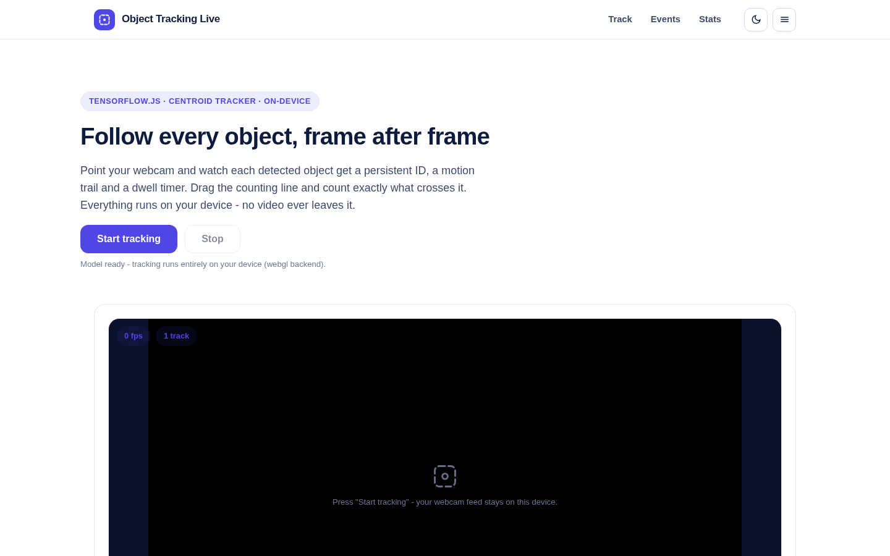
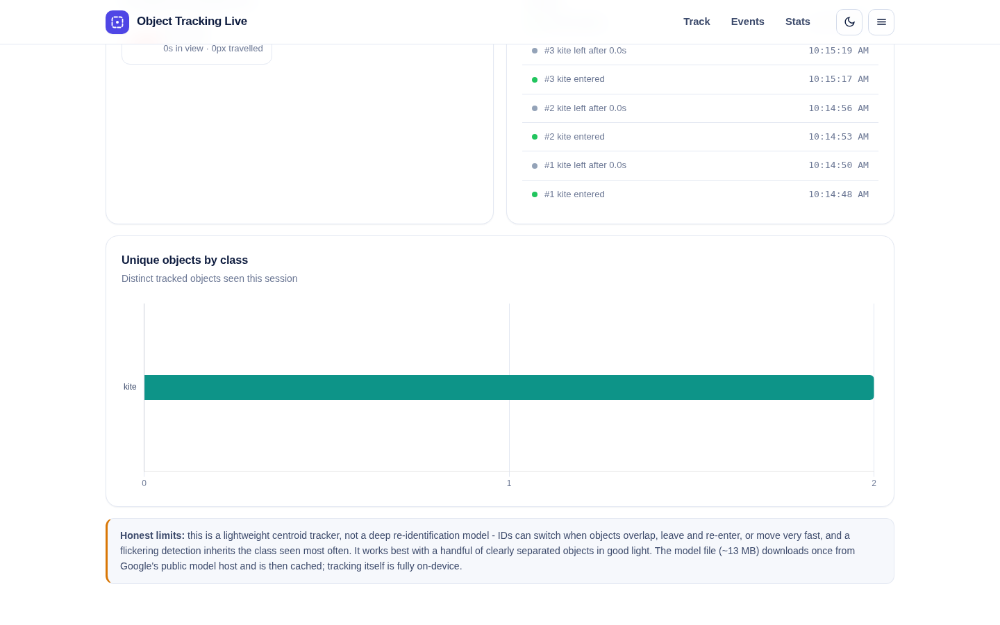
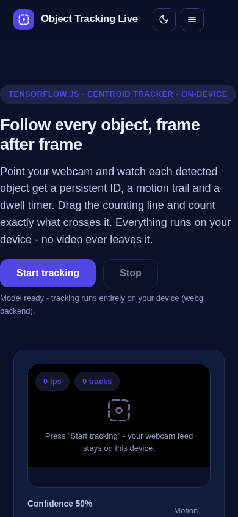

# Object Tracking Live

Track moving objects on your webcam in real time, entirely in the browser. Each detected object gets a persistent ID, a motion trail and a dwell timer; a draggable counting line tallies exactly what crosses it, and in which direction. No video ever leaves your device.

**Live demo:** https://akash991833.github.io/object-tracking-live/



## Features

- **Persistent track IDs** - a centroid tracker matches detections frame to frame, so "person #1" stays "person #1" while they move.
- **Motion trails** - the last 40 positions of every track, drawn live.
- **Draggable counting line** - drag the amber line anywhere on the video; every crossing is counted by direction (up/down) and logged.
- **Event log** - entries ("cup #2 entered"), exits ("person #1 left after 12.3s") and crossings, with timestamps.
- **Live KPIs** - active tracks, unique objects this session, longest dwell time.
- **Class stats chart** - unique tracked objects per class, updated live.
- **Class-flicker resistance** - a track's label is the class seen most often, not the latest guess.
- **Runs 100% on-device** - TensorFlow.js COCO-SSD detections plus a lightweight tracker; no server, no uploads, no account.
- **Dark and light themes**, mobile and desktop layouts, installable PWA.



## Tech stack

Plain HTML/CSS/JS with [TensorFlow.js](https://www.tensorflow.org/js), the COCO-SSD `lite_mobilenet_v2` detector, a custom centroid tracker (nearest-centroid matching with EMA smoothing and age-based expiry), Chart.js for stats, and a service worker for offline use. Model weights load from the public tfjs-models bucket on first run and are cached afterwards.

## Run locally

```bash
python3 -m http.server 8057
# open http://localhost:8057
```

## Tests

```bash
NODE_PATH=<repo-parent>/node_modules node tests/run.mjs
```

Puppeteer suite covering desktop and mobile in both themes: deterministic tracker unit tests (persistent IDs, entry/exit events, line crossing by direction, class-flicker stability, track archiving) through the app's own `_test` hooks, plus a real-model webcam smoke test (loop running, overlay sized, draggable counting line, stop button), screenshots, and a zero-console-error check.

## Honest limits

- This is a lightweight centroid tracker, not a deep re-identification model: IDs can switch when objects overlap, leave and re-enter, or move faster than the match distance between frames.
- It inherits the detector's 80 COCO classes and its misses; small or occluded objects may not be tracked at all.
- Webcam access and decent lighting are required; frame rate depends on your device's GPU/CPU.
- Tracks are session-only: reload the page and the counts start fresh.


